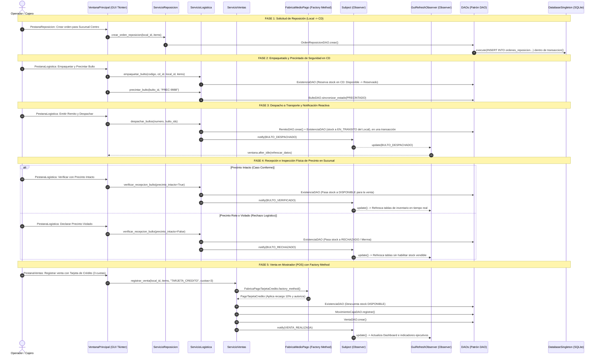

# TRABAJO PRÁCTICO INTEGRADOR (TPI)
## DISEÑO Y ARQUITECTURA DE OBJETOS (DAO) - UTN FRC 2026
### Sistema Integrado de Ventas, Logística e Inventario: Centro de Distribución y Locales Comerciales

---

## 1. RESUMEN EJECUTIVO Y DOMINIO DEL NEGOCIO

El presente proyecto implementa un **Sistema Empresarial de Gestión Logística, Control de Inventario y Ventas en Mostrador (POS)** para una cadena minorista estructurada bajo una topología jerárquica de distribución (*Hub and Spoke*).

```
   ┌──────────────────────────────────────────────┐
   │    CENTRO DE DISTRIBUCIÓN CENTRAL (CD)       │
   │  - Abastecimiento mayorista (Compras)        │
   │  - Consolidación y armado de bultos          │
   │  - Precintado de seguridad y remitos         │
   └──────┬────────────────────────────────┬──────┘
          │ (Despacho / Tránsito)          │ (Despacho / Tránsito)
          ▼                                ▼
   ┌──────────────────────┐         ┌──────────────────────┐
   │ SUCURSAL CENTRO      │         │ SUCURSAL NORTE       │
   │ - Verificación física│         │ - Verificación física│
   │ - Stock Disponible   │         │ - Stock Disponible   │
   │ - Venta POS          │         │ - Venta POS          │
   └──────────────────────┘         └──────────────────────┘
```

### 1.1. Principio Fundamental de Segregación de Inventario
El sistema garantiza que **ninguna mercadería ingrese al stock vendible sin verificación física fehaciente en destino**. Para ello, el inventario se gestiona mediante un modelo estricto de **Cuatro Baldes de Stock**:
1. **Disponible (`disponible`):** Mercadería físicamente verificada en la sucursal, apta para ser comercializada en el punto de venta.
2. **Reservado (`reservado`):** Mercadería comprometida en el Centro de Distribución (CD) para el armado de bultos asociados a una solicitud de reposición.
3. **En Tránsito (`en_transito`):** Mercadería despachada desde el CD y transportada hacia el local de destino bajo remito formal y precinto de seguridad.
4. **Rechazado / Merma (`rechazado`):** Mercadería siniestrada, con precinto violado durante el transporte o devuelta por clientes en condiciones defectuosas. **Bajo ninguna circunstancia habilita su comercialización.**

### 1.2. Marco Académico y Tecnológico
Desarrollado en estricta conformidad con el programa de **Diseño y Arquitectura de Objetos (DAO)** de la Universidad Tecnológica Nacional - Facultad Regional Córdoba:
- **Persistencia y Arquitectura:** `Apuntes/semana7.pdf` (Capítulo 13: *Bases de datos con SQLite3*, Sección 13.10: *Patrón DAO*).
- **Patrones de Diseño Formales GoF:** `Filminas/Semana 7 2026.pdf` y ejemplos canónicos de `Extra/patrones/patrones/` (*Singleton*, *Factory Method*, *Observer*).
- **Interfaz de Usuario:** Aplicación de escritorio nativa desacoplada desarrollada en Python 3.12 con **Tkinter / ttk**, sincronizada reactivamente mediante el patrón *Observer*, con modo claro y modo oscuro (`interfaz/estilos.py`, la preferencia se guarda en `datos/preferencias.json`).

---

## 2. PATRONES DE DISEÑO IMPLEMENTADOS Y JUSTIFICACIÓN TÉCNICA

La consigna de la cátedra establece la obligatoriedad de implementar y justificar formalmente al menos dos patrones de diseño. En este proyecto se implementaron **cinco patrones**: los **tres patrones GoF de la materia** (*Singleton*, *Factory Method* y *Observer*), el **patrón arquitectónico DAO** y el **patrón GoF *State*** para el ciclo de vida del bulto (sección 2.5):

```mermaid
classDiagram
    direction TB

    %% SINGLETON
    class DatabaseSingleton {
        <<Singleton (Semana 7 / database.py)>>
        -_instance: DatabaseSingleton
        +connection: sqlite3.Connection
        +__new__(db_path) DatabaseSingleton
        +execute(sql, parametros) Cursor
        +fetch_all(sql, parametros) list
        +fetch_one(sql, parametros) Row
        +transaccion() ContextManager
        +close_connection()
    }

    %% FACTORY METHOD
    class Factory {
        <<Factory (Semana 7 / factory.py)>>
        +factory_method()* Product
    }
    class FabricaMedioPago {
        <<Factory Abstracta>>
        +factory_method()* MedioPago
    }
    class FabricaPagoEfectivo {
        +factory_method() PagoEfectivo
    }
    class FabricaPagoTarjetaDebito {
        +factory_method() PagoTarjetaDebito
    }
    class FabricaPagoTarjetaCredito {
        +factory_method() PagoTarjetaCredito
    }
    class FabricaPagoTransferenciaQR {
        +factory_method() PagoTransferenciaQR
    }
    class Product {
        <<Product (Semana 7 / factory.py)>>
        +operation()*
    }
    class MedioPago {
        <<Product Abstracto>>
        +calcular_recargo(monto, datos)*
        +procesar(monto, datos)*
        +permite_devolucion_efectivo()*
    }
    class PagoEfectivo
    class PagoTarjetaDebito
    class PagoTarjetaCredito
    class PagoTransferenciaQR

    Factory <|-- FabricaMedioPago
    FabricaMedioPago <|-- FabricaPagoEfectivo
    FabricaMedioPago <|-- FabricaPagoTarjetaDebito
    FabricaMedioPago <|-- FabricaPagoTarjetaCredito
    FabricaMedioPago <|-- FabricaPagoTransferenciaQR

    Product <|-- MedioPago
    MedioPago <|-- PagoEfectivo
    MedioPago <|-- PagoTarjetaDebito
    MedioPago <|-- PagoTarjetaCredito
    MedioPago <|-- PagoTransferenciaQR

    FabricaMedioPago ..> MedioPago : crea mediante factory_method()

    %% OBSERVER
    class Subject {
        <<Subject (Semana 7 / observer.py)>>
        -_observers: list
        -_data: Any
        +attach(observer)
        +detach(observer)
        +notify(data)
        +set_data(data)
    }
    class Observer {
        <<Observer (Semana 7 / observer.py)>>
        +update(data)*
    }
    class AlertaStockMinimoObserver {
        +update(data)
    }
    class AuditoriaLogisticaObserver {
        +update(data)
    }
    class GuiRefreshObserver {
        <<WindowObserver (windobserver.py)>>
        +update(data)
    }

    Observer <|-- AlertaStockMinimoObserver
    Observer <|-- AuditoriaLogisticaObserver
    Observer <|-- GuiRefreshObserver
    Subject o-- Observer : notifica

    %% DAO
    class UbicacionDAO {
        <<DAO (semana7.pdf Sec 13.10)>>
        +crear()
        +obtener_por_id()
        +listar()
    }
    class ProductoDAO {
        <<DAO (semana7.pdf Sec 13.10)>>
        +crear()
        +obtener_por_codigo()
        +listar()
    }

    %% STATE
    class Bulto {
        <<Context (State)>>
        -_estado: EstadoBulto
        +precintar(numero_precinto)
        +despachar()
        +recibir()
        +verificar(precinto_intacto, motivo)
        +anular(motivo)
        +cambiar_estado(nuevo_estado, motivo)
    }
    class EstadoBulto {
        <<State (estados_bulto.py)>>
        +precintar(bulto, numero_precinto)
        +despachar(bulto)
        +recibir(bulto)
        +verificar(bulto, precinto_intacto, motivo)
        +anular(bulto, motivo)
    }
    class EstadoPreparado
    class EstadoPrecintado
    class EstadoEnTransito
    class EstadoRecibido
    class EstadoVerificado
    class EstadoRechazado
    class EstadoAnulado

    Bulto o-- EstadoBulto : delega en
    EstadoBulto <|-- EstadoPreparado
    EstadoBulto <|-- EstadoPrecintado
    EstadoBulto <|-- EstadoEnTransito
    EstadoBulto <|-- EstadoRecibido
    EstadoBulto <|-- EstadoVerificado
    EstadoBulto <|-- EstadoRechazado
    EstadoBulto <|-- EstadoAnulado
```



---

### 2.1. Patrón Creacional: SINGLETON
- **Referencia Cátedra:** `Extra/patrones/patrones/singleton/singleton.py` y `Extra/patrones/patrones/caso-observer-singleton/database.py`.
- **Ubicación en el Proyecto:** [`app/persistencia/conexion.py`](app/persistencia/conexion.py) $\rightarrow$ `DatabaseSingleton`.
- **Problema de Ingeniería y Justificación:**
  SQLite es un motor embebido basado en bloqueo de archivos a nivel de sistema operativo. Abrir múltiples instancias de conexión en un entorno con interfaz gráfica genera bloqueos de contención (`database is locked`), degradación de rendimiento y riesgo de transacciones colisionadas.
- **Implementación Técnica:**
  - Control de instanciación mediante `__new__(cls, db_path=None)` con variable de clase estática `_instance = None`.
  - Apertura de la conexión en `_abrir()`, que se ejecuta una sola vez.
  - Configuración estricta de base de datos según `semana7.pdf`:
    - `PRAGMA foreign_keys = ON;` para forzar integridad referencial relacional.
    - `connection.row_factory = sqlite3.Row` para desacoplar el acceso por tuplas posicionales y permitir indexación nominal.
  - Context Manager `transaccion()` para atomicidad (`COMMIT` o `ROLLBACK`) y métodos `execute()`, `fetch_all()`, `fetch_one()` y `close_connection()`. Equivalencias con `database.py` de la cátedra: `execute_query()` es `execute()` dentro de un `with transaccion():` y `fetch_query()` es `fetch_all()`.

---

### 2.2. Patrón Creacional: FACTORY METHOD
- **Referencia Cátedra:** `Extra/patrones/patrones/factory/factory.py` y `Filminas/Semana 7 2026.pdf` (Diapositivas 9 a 13).
- **Ubicación en el Proyecto:** [`app/dominio/medios_pago.py`](app/dominio/medios_pago.py).
- **Problema de Ingeniería y Justificación:**
  El proceso de cobro en mostrador (Proceso 7) exige operar con múltiples modalidades de pago heterogéneas (`EFECTIVO`, `TARJETA_DEBITO`, `TARJETA_CREDITO`, `TRANSFERENCIA_QR`), cada una con validaciones específicas, políticas financieras de recargo y comportamiento diferenciado ante devoluciones. El patrón desacopla al cliente ([`ServicioVentas`](app/servicios/servicio_ventas.py)) de las clases concretas, cumpliendo el Principio de Abierto/Cerrado (OCP).
- **Estructura de Clases:**
  1. `Product(ABC)`: Interfaz del producto con método abstracto `operation()`.
  2. `MedioPago(Product, ABC)`: Contrato de negocio con métodos:
     - `calcular_recargo(monto, datos) -> float`
     - `procesar(monto, datos) -> ResultadoPago`
     - `permite_devolucion_efectivo() -> bool`
  3. `ConcreteProduct`:
     - `PagoEfectivo`: Valida monto entregado $\ge$ total, calcula vuelto e impacta en caja física.
     - `PagoTarjetaDebito`: Requiere número de tarjeta y genera token de autorización.
     - `PagoTarjetaCredito`: Aplica esquema de recargo financiero por cuotas (1 cuota: 0%, 3 cuotas: 10%, 6 cuotas: 20%; cualquier otro plan de cuotas se rechaza).
     - `PagoTransferenciaQR`: Exige billetera virtual y código de operación unívoco.
  4. `Factory(ABC)`: Fábrica abstracta canónica con `@abstractmethod def factory_method(self) -> MedioPago:`.
  5. `ConcreteFactory`:
     - `FabricaPagoEfectivo`, `FabricaPagoTarjetaDebito`, `FabricaPagoTarjetaCredito`, `FabricaPagoTransferenciaQR`.
  6. `MedioPagoFactory`: Punto de acceso que resuelve la factoría concreta a partir del código del medio de pago (texto con los valores de `TipoMedioPago`, p. ej. `"TARJETA_CREDITO"`).
- **Aclaración:** `crear_ubicacion()` (`dominio/ubicaciones.py`) y `crear_estado_bulto()` (`dominio/estados_bulto.py`) son *Simple Factory* (una función que elige la clase según un texto leído de la base). No forman parte del Factory Method formal, que es exclusivamente el de medios de pago.

---

### 2.3. Patrón de Comportamiento: OBSERVER
- **Referencia Cátedra:** `Extra/patrones/patrones/observer/observer.py`, `caso-observer-singleton/observer.py` y `windobserver.py`.
- **Ubicación en el Proyecto:** [`app/patrones/observer.py`](app/patrones/observer.py).
- **Problema de Ingeniería y Justificación:**
  Los eventos operacionales del negocio (movimiento de stock, despacho logístico, recepción conforme o rechazo por precinto violado, venta POS) requieren notificar a subsistemas transversales sin introducir acoplamiento rígido (relación 1-a-N).
- **Implementación Técnica:**
  1. `Subject`: Gestiona lista de observadores (`_observers: List[Observer]`), exponiendo `attach()`, `detach()`, `notify()` y `set_data()`.
  2. `Observer(ABC)`: Interfaz abstracta con `@abstractmethod def update(self, data: Any = None) -> None:`.
  3. Observadores Concretos:
     - `AlertaStockMinimoObserver`: Reacciona ante eventos `STOCK_CAMBIO`. Si el producto está en su mínimo o por debajo (`esta_en_stock_minimo` en [`stock.py`](app/dominio/stock.py): `disponible <= mínimo de la ubicación`; en un local es el `stock_minimo` del producto y en el CD `stock_minimo × MULTIPLICADOR_MINIMO_CD`, según `Ubicacion.stock_minimo_para`; salvo un mínimo de 0, que significa "sin punto de reposición" y nunca alerta), persiste la alerta (o, si ya había una activa, actualiza sus valores); si las existencias se recomponen, resuelve la alerta en base de datos. La tabla `alertas_stock` queda como **historial** de cuándo cada producto entró y salió de estado crítico.
     - `AuditoriaLogisticaObserver`: Captura eventos `BULTO_RECHAZADO`, `BULTO_VERIFICADO` o `BULTO_DESPACHADO`, asentando un registro inmutable de auditoría.
     - `GuiRefreshObserver`: Conectado a la [`VentanaPrincipal`](app/interfaz/ventana_principal.py) de Tkinter (**análogo directo al `WindowObserver` de la cátedra**). Todo corre en el único hilo de Tkinter: el evento llega en medio de la operación de negocio, así que el refresco se difiere con `ventana.after_idle(callback)` hasta que la transacción terminó, y varios eventos seguidos producen un solo refresco.
  4. Eventos emitidos: **todas** las operaciones de negocio avisan al `Subject`. Cada `EventoObserver` lleva, además de `tipo` y `datos`, una `descripcion` legible (por ejemplo *"Orden de compra #4 emitida a Arcor S.A.I.C.: 2 producto(s), 350 unidades (PENDIENTE de recepción)"*), que es lo que muestran la cabecera y la bitácora del Inicio:

     | Servicio | Eventos |
     |---|---|
     | `ServicioMaestros` | `UBICACION_REGISTRADA` / `_ACTUALIZADA` / `_DADA_DE_BAJA` / `_REACTIVADA`, `CATEGORIA_REGISTRADA` / `_ACTUALIZADA` / `_ELIMINADA`, `PROVEEDOR_REGISTRADO` / `_ACTUALIZADO` / `_DADO_DE_BAJA` / `_REACTIVADO`, `PRODUCTO_REGISTRADO` / `_ACTUALIZADO` / `_DADO_DE_BAJA` / `_REACTIVADO` |
     | `ServicioCompras` | `ORDEN_COMPRA_EMITIDA`, `ORDEN_COMPRA_RECIBIDA`, `ORDEN_COMPRA_CANCELADA` |
     | `ServicioReposicion` | `ORDEN_REPOSICION_CREADA`, `ORDEN_REPOSICION_CANCELADA` |
     | `ServicioLogistica` | `BULTO_PREPARADO`, `BULTO_PRECINTADO`, `REMITO_EMITIDO`, `BULTO_DESPACHADO`, `BULTO_VERIFICADO`, `BULTO_RECHAZADO`, `REMITO_VERIFICADO` |
     | `ServicioVentas` / `ServicioDevoluciones` | `VENTA_REALIZADA`, `DEVOLUCION_REGISTRADA` |
     | `ServicioInventario` | `STOCK_CAMBIO` (cada movimiento), `INVENTARIO_AJUSTADO` (conteo físico) |
  5. `Subject.notify()` aísla a cada observador: si uno falla, la excepción se registra con `logging.exception` y el resto sigue recibiendo el evento.
  6. Los observadores que actúan **fuera** de la base (la bitácora de la pantalla y la auditoría logística) anotan el evento recién cuando la operación se confirma, con `DatabaseSingleton.al_confirmar()`. Si la transacción se deshace, el evento no aparece: antes la bitácora podía mostrar, por ejemplo, un movimiento de stock de una venta que había fallado (`test_la_bitacora_no_anota_operaciones_que_se_deshacen`). El `AlertaStockMinimoObserver` escribe en la base dentro de la misma transacción, así que se deshace junto con ella.
- **Lista "Productos en su stock mínimo o por debajo" del Inicio:** no se arma desde `alertas_stock`, porque esa tabla sólo se escribe cuando hay un movimiento de stock y no veía los productos que nunca llegaron a un local ni los cambios del mínimo. Se calcula con `ServicioInventario.listar_productos_bajo_minimo()` → `ExistenciaDAO.listar_bajo_minimo()`, que cruza locales × productos activos con las existencias actuales (sin fila = 0 disponible). Los productos con mínimo 0 no figuran (la misma regla rige para Inventario, el Reporte 3 y las sugerencias de reposición y de compra). El CD se excluye: el `stock_minimo` es un mínimo por local, y el CD se repone desde Compras con su propio mínimo. Un selector arriba de la tabla permite ver "Todos los locales" o uno en particular (`ubicacion_id`); la tarjeta "Alertas de stock" siempre resume a toda la cadena.

---

### 2.4. Patrón Arquitectónico: DATA ACCESS OBJECT (DAO)
- **Referencia Cátedra:** `Apuntes/semana7.pdf` (Capítulo 13, Sección 13.10: *"Patrón DAO (Data Access Object)"*, págs. 13-16).
- **Ubicación en el Proyecto:** Directorio [`app/persistencia/`](app/persistencia/) (9 módulos DAO que agrupan 14 clases especializadas).
- **Problema de Ingeniería y Justificación:**
  Separa la lógica de negocio y las entidades de dominio de los detalles de implementación relacional y consultas SQL. Cada módulo agrupa los DAOs de un área del negocio, responsables de sus operaciones CRUD y consultas especializadas:
  1. [`dao_ubicacion.py`](app/persistencia/dao_ubicacion.py) (`UbicacionDAO`): Gestión de Centros de Distribución y Sucursales.
  2. [`dao_catalogo.py`](app/persistencia/dao_catalogo.py) (`CategoriaDAO`, `ProveedorDAO`, `ProductoDAO`): Categorías, Proveedores (CUIT) y Productos (SKU).
  3. [`dao_stock.py`](app/persistencia/dao_stock.py) (`ExistenciaDAO`, `MovimientoStockDAO`, `AlertaStockDAO`): Control atómico de existencias en los 4 baldes y movimientos.
  4. [`dao_compras.py`](app/persistencia/dao_compras.py) (`OrdenCompraDAO`): Órdenes de compra mayoristas a fábricas.
  5. [`dao_reposicion.py`](app/persistencia/dao_reposicion.py) (`OrdenReposicionDAO`): Pedidos de abastecimiento entre nodos.
  6. [`dao_logistica.py`](app/persistencia/dao_logistica.py) (`BultoDAO`, `RemitoDAO`): Bultos, precintos, remitos y trazabilidad histórica.
  7. [`dao_ventas.py`](app/persistencia/dao_ventas.py) (`VentaDAO`): Cabeceras de ticket, ítems con costo histórico y cobros.
  8. [`dao_devoluciones.py`](app/persistencia/dao_devoluciones.py) (`DevolucionDAO`): Devoluciones y notas de crédito.
  9. [`dao_caja.py`](app/persistencia/dao_caja.py) (`MovimientoCajaDAO`): Arqueo y movimientos contables de caja física.

---

### 2.5. Ciclo de Vida del Bulto Logístico: State Pattern y Polimorfismo
- **Ubicación en el Proyecto:** [`app/dominio/estados_bulto.py`](app/dominio/estados_bulto.py) y [`app/dominio/bulto.py`](app/dominio/bulto.py).
- **Diseño Orientado a Objetos:**
  En lugar de utilizar banderas condicionales primitivas (`if estado == "X"`), el ciclo de vida se modeló formalmente mediante **polimorfismo puro**:
  - Clase base `EstadoBulto(ABC)` que declara las cinco transiciones (`precintar`, `despachar`, `recibir`, `verificar`, `anular`). Por defecto cada una lanza `TransicionInvalidaError`; cada estado concreto redefine sólo las que le están permitidas (por eso no usa `@abstractmethod`).
  - Clases de estado concreto:
    - `EstadoPreparado`: Mercadería empaquetada. Stock en CD queda en estado `RESERVADO`. Permite precintar o anular.
    - `EstadoPrecintado`: Se asigna el identificador único de precinto. Permite despachar, o anular mientras no tenga remito.
    - `EstadoEnTransito`: Bulto despachado. Stock pasa de `RESERVADO` en CD a `EN_TRANSITO` en la sucursal de destino.
    - `EstadoRecibido`: Camión arribado a puerta de sucursal (`ServicioLogistica.registrar_recepcion_bulto`, paso 4 de la pantalla). El stock sigue en tránsito. Habilita la inspección del precinto (paso 5).
    - `EstadoVerificado`: **Precinto intacto.** Su mercadería pasa a `DISPONIBLE` cuando el remito completo queda verificado (todos sus bultos controlados): "remito y contenedor en estado Verificado".
    - `EstadoRechazado`: **Precinto violado/roto.** Pasa el stock a `RECHAZADO` (merma). **Bajo ninguna condición habilita la venta.**
    - `EstadoAnulado`: el CD desarmó el bulto antes de despacharlo (`ServicioLogistica.anular_bulto`). Lo reservado vuelve a `DISPONIBLE` en el CD; el precinto, si tenía, queda inutilizado. Si el bulto atendía una orden de reposición que se quedó sin bultos, la orden vuelve a `SOLICITADA`.
  - Los estados sólo deciden **qué transición es válida**. El movimiento de stock entre baldes que acompaña a cada transición lo hace `ServicioLogistica` (vía `ServicioInventario.aplicar_movimiento`) dentro de la misma transacción.
  - Cada transición inválida eleva `TransicionInvalidaError`, y cada cambio de estado registra un asiento histórico inmutable en `historico_estados_bulto`. La inmutabilidad también la garantiza la base: dos triggers (`trg_historico_bulto_sin_update` y `trg_historico_bulto_sin_delete`, en `esquema.py`) abortan cualquier `UPDATE` o `DELETE` sobre el histórico.

---

## 3. MATRIZ DE TRAZABILIDAD Y CUMPLIMIENTO DEL ENUNCIADO

A continuación se detalla la verificación rigurosa de cada requerimiento funcional, regla de negocio y reporte exigido en el `enunciado.pdf`:

| Requerimiento del Enunciado | Tipo | Estado | Componente de Software | Evidencia / Test Automatizado |
|---|:---:|:---:|---|---|
| **1. Administrar sucursales y CD** | Proceso Obligatorio | ✅ Cumplido | [`ServicioMaestros`](app/servicios/servicio_maestros.py) / [`PestanaMaestros`](app/interfaz/pestanas/pestana_maestros.py) | `test_registro_ubicaciones_y_limite_un_solo_cd` (Impide duplicación de CD central). Alta, modificación (nombre y dirección), baja lógica y reactivación de locales. El CD no se da de baja (lo decide `CentroDistribucion`, por polimorfismo) y un local tampoco mientras tenga stock, bultos en camino u órdenes de reposición abiertas. Un local dado de baja no vende, no recibe bultos ni pide reposición (`test_requisitos_consigna.py`). |
| **2. Administrar productos, categorías, precios, mínimos y proveedores** | Proceso Obligatorio | ✅ Cumplido | [`ServicioMaestros`](app/servicios/servicio_maestros.py) / [`dao_catalogo.py`](app/persistencia/dao_catalogo.py) (`CategoriaDAO`, `ProveedorDAO`, `ProductoDAO`) | `test_catalogo_unicidad_sku_y_validaciones`, `test_proveedores_normalizacion_y_prevencion_duplicados_cuit` (normalización del CUIT y dígito verificador por Módulo 11 de AFIP en `Proveedor.calcular_digito_verificador`). Teléfono sin letras y email con forma `usuario@dominio.ext` (`validar_telefono_opcional` / `validar_email_opcional` en `dominio/validaciones.py`, `test_validaciones_datos.py`). Modificación de precios y stock mínimo: `test_modificar_precios_y_stock_minimo_de_un_producto`. Modificación completa de productos (nombre, categoría, proveedor, precios y mínimo), proveedores (razón social y contacto) y categorías; baja lógica y reactivación de productos y proveedores, y eliminación de categorías sin productos. Las bajas se rechazan si dejarían algo a medias: un producto con unidades en la red o pedidos abiertos, un proveedor con productos activos u órdenes de compra pendientes (`test_requisitos_consigna.py`). |
| **3. Consolidar reposiciones Local $\rightarrow$ CD** | Proceso Obligatorio | ✅ Cumplido | [`ServicioReposicion`](app/servicios/servicio_reposicion.py) / [`PestanaReposicion`](app/interfaz/pestanas/pestana_reposicion.py) | `test_orden_de_reposicion_se_completa_al_verificar_sus_bultos`. Sugerencias por punto de pedido, consolidación con cabecera y detalle, y ciclo SOLICITADA → EN_PREPARACION → DESPACHADA → COMPLETADA con seguimiento de unidades despachadas. Sólo se cancela mientras está SOLICITADA: con bultos armados ya tiene stock reservado (`test_solo_una_orden_solicitada_se_puede_cancelar`, `test_una_orden_con_bultos_armados_no_se_cancela`). Los productos pedidos tienen que existir (`test_compras_y_reposicion.py`). Una orden despachada en parte sigue abierta y acepta otro bulto con lo que falta; recién se completa cuando se envió todo y se verificaron sus bultos (`test_una_orden_despachada_en_parte_sigue_abierta_y_se_completa_despues`). |
| **4. Empacar mercadería con remito y precinto** | Proceso Obligatorio | ✅ Cumplido | [`ServicioLogistica`](app/servicios/servicio_logistica.py) / [`PestanaLogistica`](app/interfaz/pestanas/pestana_logistica.py) | `test_restricciones_de_transicion_y_unicidad_de_precintos`. Emisión legal de remitos. El bulto sale del CD hacia un local; si atiende una orden de reposición, va al local de la orden, lleva sólo productos pedidos y no se pasa de lo que falta armar; un bulto viaja con un solo remito y un remito puede amparar varios bultos del mismo local (`test_logistica_reglas.py`). |
| **5. Registrar despacho desde CD** | Proceso Obligatorio | ✅ Cumplido | [`ServicioLogistica`](app/servicios/servicio_logistica.py) | Transfiere stock a `EN_TRANSITO` y notifica al Observer. Desde la pantalla, emitir el remito y despacharlo es una sola transacción (`despachar_bultos`): si el despacho falla no queda un remito suelto (`test_si_el_despacho_falla_no_queda_un_remito_suelto`). |
| **6. Recepción y verificación de precinto** | Proceso Obligatorio | ✅ Cumplido | [`ServicioLogistica`](app/servicios/servicio_logistica.py) | `test_flujo_exitoso_state_precinto_intacto_habilita_disponible` vs `test_rechazo_logistico_por_precinto_roto_no_habilita_venta`. Con varios bultos en un remito, el stock pasa a disponible recién cuando se verificaron todos (`test_un_remito_con_dos_bultos_libera_el_stock_al_verificarse_completo`). |
| **7. Ventas POS con medios de pago y devoluciones** | Proceso Obligatorio | ✅ Cumplido | [`ServicioVentas`](app/servicios/servicio_ventas.py), [`ServicioDevoluciones`](app/servicios/servicio_devoluciones.py) | `test_patron_factory_method_creacion_de_medios_de_pago`, `test_no_vender_cantidades_superiores_al_stock_disponible`, `test_devoluciones.py`, `test_devolucion_de_venta_con_tarjeta_no_descuadra_el_efectivo`. La pantalla de venta arma un pedido con uno o más productos antes de cobrar. El monto en efectivo y las cuotas se validan como cualquier dato: un texto, NaN o infinito no cubren el total (`test_el_efectivo_entregado_tiene_que_ser_un_monto_valido`, `test_las_cuotas_tienen_que_ser_un_entero`). La devolución reintegra lo que el cliente pagó: el precio más la parte proporcional del recargo de la tarjeta de crédito, sin perder centavos entre devoluciones parciales (`test_la_devolucion_reintegra_el_recargo_proporcional_de_la_tarjeta`). |
| **V1. Stock no ingresa a Disponible sin verificación** | Validación Crítica | ✅ Cumplido | [`ServicioLogistica`](app/servicios/servicio_logistica.py) (`_evaluar_cierre_remito`) | Un bulto verificado no libera stock por sí solo: lo que traen sus bultos verificados pasa de `EN_TRANSITO` a `DISPONIBLE` recién cuando todos los bultos del remito están controlados y el remito queda `VERIFICADO` (o `CON_RECHAZO`, verificado con algún bulto rechazado). El precinto roto deriva exclusivamente al balde `RECHAZADO` (`test_un_remito_con_dos_bultos_libera_el_stock_al_verificarse_completo`, `test_un_remito_con_un_bulto_rechazado_libera_solo_los_verificados`). |
| **V2. Trazabilidad inmutable de estados del bulto** | Validación Crítica | ✅ Cumplido | [`dao_logistica.py`](app/persistencia/dao_logistica.py) (`BultoDAO`, `RemitoDAO`) / [`HistoricoEstadoBulto`](app/dominio/bulto.py) | `test_trazabilidad_inmutable_de_historico_estados` (Historial cronológico completo). |
| **V3. No vender sin stock disponible y verificado** | Validación Crítica | ✅ Cumplido | [`ServicioVentas`](app/servicios/servicio_ventas.py) | Lanza excepción tipada `StockInsuficienteError` ante intentos de sobreventa. |
| **Tope de stock disponible (10.000.000 u.)** | Validación | ✅ Cumplido | [`Existencia.aplicar`](app/dominio/stock.py) / `STOCK_DISPONIBLE_MAXIMO` en [`config.py`](app/config.py) | `test_el_disponible_no_puede_superar_el_maximo`, `test_conteo_fisico_por_encima_del_maximo_no_cambia_el_stock`. Rechaza compras, ajustes o devoluciones que dejen el disponible por encima del tope, sin modificar nada. |
| **Importes numéricos válidos** | Validación | ✅ Cumplido | [`dominio/validaciones.py`](app/dominio/validaciones.py) | `test_nan_e_infinito_no_son_importes_validos`, `test_un_producto_no_puede_quedar_con_precio_infinito`. `float()` acepta `"nan"` e `"inf"`; los validadores los rechazan, así ningún precio, costo ni pago queda en NaN o infinito. |
| **Códigos de documentos** | Validación | ✅ Cumplido | [`requerir_codigo`](app/dominio/validaciones.py) | `test_un_numero_de_comprobante_invalido_se_rechaza_con_un_mensaje_claro`, `test_los_codigos_de_bulto_remito_precinto_y_nota_de_credito_se_validan`. Ticket, nota de crédito, remito, bulto y precinto sólo admiten letras, números, `-` y `_` (hasta 30). El número del comprobante es también el nombre de su archivo: así no puede apuntar a otra carpeta ni a otra unidad. |
| **DNI del cliente en ventas** | Validación | ✅ Cumplido | [`validar_dni_opcional`](app/dominio/validaciones.py) / [`Venta`](app/dominio/ventas.py) | `test_dni_valido`, `test_dni_invalido_no_registra_la_venta`. Opcional; si se carga, sólo números y 7 u 8 dígitos. |
| **V4. Prevención de identificadores duplicados** | Validación Crítica | ✅ Cumplido | [`ServicioMaestros`](app/servicios/servicio_maestros.py) | Bloquea duplicados de SKU, de nombre por proveedor (también al modificar) y de CUIT. En la base, además, son únicos los números de remito, comprobante, nota de crédito y precinto. |
| **V5. Control legal de devoluciones (plazo 30 días)** | Validación Crítica | ✅ Cumplido | [`ServicioDevoluciones`](app/servicios/servicio_devoluciones.py) | `test_rechazo_devolucion_fuera_del_plazo_de_30_dias`, `test_un_local_dado_de_baja_no_recibe_devoluciones`. Emite Nota de Crédito. Un local dado de baja no recibe devoluciones (no recibe mercadería). |
| **R1. Ventas e ingresos por período, local y medio** | Reporte Gerencial | ✅ Cumplido | [`ServicioReportes`](app/servicios/servicio_reportes.py) | `test_reporte_1_ventas_e_ingresos`. Cobrado, devuelto (notas de crédito del período, imputadas al medio de pago original) e ingreso neto, por local y medio de pago. La pantalla filtra por período y ubicación (`test_reporte_1_descuenta_las_devoluciones`, `test_reporte_1_filtra_por_local_y_por_periodo`). |
| **R2. Productos más vendidos y margen de ganancia** | Reporte Gerencial | ✅ Cumplido | [`ServicioReportes`](app/servicios/servicio_reportes.py) | `test_reporte_2_ranking_productos_y_margen`. Cálculo de margen sobre costo histórico. Muestra unidades vendidas, devueltas y netas; un producto devuelto en su totalidad sigue figurando con 0 netas (`test_producto_devuelto_en_su_totalidad_sigue_en_el_ranking`). |
| **R3. Existencias actuales y alerta stock mínimo** | Reporte Gerencial | ✅ Cumplido | [`ServicioReportes`](app/servicios/servicio_reportes.py) | `test_reporte_3_existencias_y_stock_critico`. Detección de quiebres de stock. El Inicio lista los productos en su mínimo o por debajo en cada local calculándolos sobre las existencias actuales (`test_alertas_inicio.py`). En el CD el mínimo es `stock_minimo × MULTIPLICADOR_MINIMO_CD`, la misma regla de las compras sugeridas (`test_reporte_3_usa_el_minimo_del_centro_de_distribucion`). |
| **R4. Bultos rechazados y mermas logísticas** | Reporte Gerencial | ✅ Cumplido | [`ServicioReportes`](app/servicios/servicio_reportes.py) | `test_reporte_4_bultos_rechazados_y_mermas`. Cuantificación económica de pérdidas, con filtros de período y local destino (`test_reporte_4_filtra_por_local_destino`). |
| **R5. Tránsito promedio y valorización de inventario** | Reporte Gerencial | ✅ Cumplido | [`ServicioReportes`](app/servicios/servicio_reportes.py) | `test_reporte_5_tiempo_transito_y_valorizacion_inventario`. Tiempo promedio CD → locales (total y por local), movimientos del inventario del período por tipo (cantidad, unidades y valor al costo) y valorización por balde (`test_reporte_5_incluye_movimientos_y_transito_por_local`). |

---

### 3.1. Errores corregidos en la revisión de código (noviembre 2026)

| Error | Qué pasaba | Corrección y prueba |
|---|---|---|
| Orden de reposición despachada en parte | Si el CD mandaba sólo una parte, la orden pasaba a DESPACHADA, ya no aceptaba más bultos y se completaba al verificar ese envío, con unidades nunca enviadas | Una orden DESPACHADA acepta bultos mientras le falten unidades y se completa recién con todo enviado y verificado (`test_una_orden_despachada_en_parte_sigue_abierta_y_se_completa_despues`) |
| Conteo físico no atómico | Si un renglón fallaba (por ejemplo, por superar el tope), los anteriores quedaban ajustados; además el resultado informaba mal el valor anterior | `realizar_inventario_fisico` corre en una transacción y devuelve el valor anterior real (`test_el_conteo_fisico_es_atomico_e_informa_el_valor_anterior`) |
| Bitácora con operaciones deshechas | Los avisos del Observer se anotaban aunque la operación fallara después y se deshiciera | `DatabaseSingleton.al_confirmar()`: la bitácora y la auditoría anotan al confirmar (`test_la_bitacora_no_anota_operaciones_que_se_deshacen`) |
| Mínimo del CD inconsistente | Compras usaba `stock_minimo × 3` para el CD, pero el Reporte 3, Inventario y las alertas usaban el mínimo de un local | `Ubicacion.stock_minimo_para()` (polimorfismo): una sola regla para todos (`test_reporte_3_usa_el_minimo_del_centro_de_distribucion`) |
| Números sugeridos repetidos | Ticket, remito, bulto, precinto y nota de crédito se sugerían como "cantidad + 1" y chocaban con un número cargado a mano | `PestanaBase.proximo_numero()` busca el siguiente libre (`test_el_numero_sugerido_no_choca_con_uno_existente`) |
| Quitar un renglón del pedido | Se quitaba por nombre: dos productos con el mismo nombre se borraban juntos | Se quita por posición en la tabla |
| Compras sugeridas a varios proveedores | Se emitía una orden por proveedor de a una: si fallaba una, las anteriores quedaban emitidas | `crear_ordenes_por_proveedor` las emite en una sola transacción |
| Errores sin mensaje | "¿Qué le falta a este local?" y "Armar bulto" podían cortar con un error en la consola (por ejemplo, sin CD) | Los dos muestran el motivo al usuario |

---

## 4. MAPA DE COMPONENTES DEL PROYECTO

El proyecto se encuentra estrictamente modularizado en capas de arquitectura limpia (*Clean Architecture*):

```text
TP-DAO/
├── app/
│   ├── config.py                 # Constantes de negocio, políticas financieras y rutas del sistema
│   ├── contexto.py               # Composition Root: Instanciación e inyección de dependencias
│   ├── datos_demo.py             # Semillero de datos iniciales representativos del negocio
│   ├── utilidades.py             # Helpers para formateo monetario y normalización de fechas ISO
│   │
│   ├── dominio/                  # Modelos de dominio puros y reglas de negocio
│   │   ├── bulto.py              # Entidad Bulto y registro inmutable de trazabilidad histórica
│   │   ├── caja.py               # Sesiones de caja física y asientos contables
│   │   ├── catalogo.py           # Categoría, Proveedor (CUIT validado módulo 11) y Producto (SKU)
│   │   ├── compras.py            # Órdenes de compra mayoristas a proveedores
│   │   ├── comprobantes.py       # Generador de comprobantes físicos (.txt): Ticket, Remito, NC
│   │   ├── devoluciones.py       # Modelo de devoluciones con validación de plazo (30 días)
│   │   ├── estados_bulto.py      # [STATE PATTERN / POLIMORFISMO] Jerarquía de estados del bulto
│   │   ├── excepciones.py        # Jerarquía tipada de excepciones de negocio
│   │   ├── medios_pago.py        # [FACTORY METHOD] Factorías y medios de cobro polimórficos
│   │   ├── remito.py             # Documento legal de despacho para transporte
│   │   ├── reposicion.py         # Solicitudes de reabastecimiento Local -> CD
│   │   ├── stock.py              # Existencias segregadas en 4 baldes y movimientos históricos
│   │   ├── ubicaciones.py        # Jerarquía de ubicaciones físicas (CD y Locales)
│   │   ├── validaciones.py       # Validaciones reutilizables de invariantes
│   │   └── ventas.py             # Ventas, detalles con captura de costo histórico y cobros
│   │
│   ├── persistencia/             # Capa de Acceso a Datos y Persistencia Relacional
│   │   ├── conexion.py           # [SINGLETON] DatabaseSingleton (semana7.pdf)
│   │   ├── esquema.py            # DDL relacional en 3FN con claves foráneas e índices
│   │   ├── dao_ubicacion.py      # [DAO] Persistencia de ubicaciones físicas
│   │   ├── dao_catalogo.py       # [DAO] Persistencia de catálogo, proveedores y categorías
│   │   ├── dao_stock.py          # [DAO] Operaciones atómicas sobre existencias y movimientos
│   │   ├── dao_compras.py        # [DAO] Persistencia de órdenes de compra a proveedores
│   │   ├── dao_reposicion.py     # [DAO] Persistencia de pedidos de reposición
│   │   ├── dao_logistica.py      # [DAO] Persistencia de bultos, precintos, remitos y auditoría
│   │   ├── dao_ventas.py         # [DAO] Persistencia de tickets de venta y renglones
│   │   ├── dao_devoluciones.py   # [DAO] Persistencia de devoluciones y notas de crédito
│   │   └── dao_caja.py           # [DAO] Persistencia de movimientos de caja física
│   │
│   ├── patrones/                 # Patrones transversales de arquitectura
│   │   └── observer.py           # [OBSERVER] Subject, Alertas, Auditoría y GuiRefreshObserver
│   │
│   ├── servicios/                # Capa de Aplicación (Casos de uso / Orquestación)
│   │   ├── servicio_maestros.py     # Servicios de gestión de catálogo y ubicaciones
│   │   ├── servicio_inventario.py   # Servicios de conciliación y ajustes físicos de stock
│   │   ├── servicio_compras.py      # Servicios de abastecimiento e ingreso al CD
│   │   ├── servicio_reposicion.py   # Algoritmo de sugerencias y solicitudes de reposición
│   │   ├── servicio_logistica.py    # Empaque, precintado, remito, despacho y verificación
│   │   ├── servicio_ventas.py       # Venta en mostrador POS con Factory Method
│   │   ├── servicio_devoluciones.py # Devolución de clientes y emisión de notas de crédito
│   │   └── servicio_reportes.py     # Ejecución y agregación de los 5 reportes estratégicos
│   │
│   └── interfaz/                 # Capa de Presentación: GUI en Tkinter / ttk
│       ├── estilos.py            # Paleta clara/oscura, tipografías y estilos ttk
│       ├── componentes.py        # Widgets reutilizables: Tabla ttk (scroll en 2 ejes, recuadro de selección), Formulario, Visor .txt
│       ├── ventana_principal.py  # Ventana raíz, Notebook de 8 pestañas y GuiRefreshObserver
│       └── pestanas/             # Vistas de los módulos operativos
│           ├── base.py           # Contrato base polimórfico de pestaña (método refrescar)
│           ├── pestana_inicio.py     # Dashboard de KPIs ejecutivos y panel de alertas activas
│           ├── pestana_maestros.py   # Mantenimiento de catálogo, sucursales y proveedores CUIT
│           ├── pestana_inventario.py # Visor de existencias en 4 baldes y ajuste físico
│           ├── pestana_compras.py    # Emisión de compras y recepción mayorista en CD
│           ├── pestana_reposicion.py # Sugerencias algorítmicas y pedidos Local -> CD
│           ├── pestana_logistica.py  # Empaque, precintos, remitos y control físico conforme/roto
│           ├── pestana_ventas.py     # Terminal POS con cobro polimórfico y devoluciones
│           └── pestana_reportes.py   # Visualizador de los 5 reportes gerenciales con filtros de período y ubicación
│
├── tests/                        # Suite de pruebas automatizadas con Pytest (181 tests passing)
│   ├── conftest.py               # Fixture con base SQLite en memoria (:memory:)
│   ├── test_maestros.py          # Pruebas de CUIT Módulo 11, SKU único y unicidad de CD
│   ├── test_logistica_state.py   # Pruebas del ciclo de vida del bulto y precintos
│   ├── test_logistica_reglas.py  # Origen/destino del bulto, coherencia con la orden, remito único y despacho atómico
│   ├── test_compras_y_reposicion.py # Productos válidos en las órdenes, cancelación y sugerencias con mínimo 0
│   ├── test_ventas_pagos.py      # Pruebas del Factory Method, recargos y stock
│   ├── test_devoluciones.py      # Pruebas de límite 30 días y condición de mercadería
│   ├── test_reportes.py          # Pruebas de cálculo contable de los 5 reportes
│   ├── test_alertas_inicio.py    # Lista de stock mínimo del Inicio y eventos del Observer
│   ├── test_validaciones_datos.py # Tope de stock disponible, teléfono y email de proveedores
│   ├── test_correcciones_revision.py # Reportes 3, 4 y 5, histórico inmutable, recepción en dos pasos, anulación de bultos, cierre con faltante, códigos de documentos y devoluciones en locales dados de baja
│   ├── test_requisitos_consigna.py # Alta/modificación/baja de maestros, remito verificado completo, recargo en devoluciones, filtros de reportes y errores de la revisión
│   └── test_eventos_y_ventas.py  # Eventos del Observer en todas las operaciones, DNI y ranking
│
├── datos/                        # Directorio de persistencia en disco
│   ├── sistema_ventas.db         # Base de datos relacional SQLite
│   └── comprobantes/             # Documentos comerciales emitidos (.txt)
│
├── main.py                       # Punto de entrada principal: Ejecución de la GUI
├── enunciado.pdf                 # Especificación original de la cátedra
├── DOCUMENTACION.md              # Documento técnico integral
└── README.md                     # Guía ejecutiva y de instalación rápida
```

---

## 5. DINÁMICA DEL SISTEMA Y DIAGRAMA DE SECUENCIA DE PUNTA A PUNTA

El siguiente diagrama detalla la interacción sincronizada entre las capas de presentación, aplicación, dominio, persistencia y patrones transversales a lo largo de un ciclo logístico y comercial completo:



---

## 5.1. ATOMICIDAD DE LAS OPERACIONES DE NEGOCIO

Cada operación de negocio toca varias tablas a la vez. Una venta, por ejemplo, descuenta
stock, asienta el cobro en la caja y graba la venta con sus ítems y pagos. Si uno de esos
pasos fallara y los anteriores ya estuvieran confirmados, la base quedaría inconsistente:
mercadería descontada de una venta que no existe, o plata en la caja sin comprobante.

Para evitarlo, los servicios envuelven su operación completa en el *context manager*
`DatabaseSingleton.transaccion()`:

```python
with self.conexion.transaccion():
    ...descuento de stock, asiento de caja, alta de la venta...
```

**Una sola regla para escribir.** Toda escritura en la base, tanto en los DAO como en los
servicios, va dentro de un `with self.conexion.transaccion():`. Ningún método llama a
`commit()` por su cuenta.

**Transacciones anidadas.** Un DAO graba la venta dentro de su propio `with`, y el servicio de
ventas envuelve todo en otro `with` más grande. `transaccion()` lleva la cuenta de cuántos
bloques hay abiertos: sólo el más externo confirma o deshace. Así, si falla el último paso de
la venta, también se deshacen los anteriores.

Operaciones protegidas: `registrar_venta`, `registrar_devolucion`, `empaquetar_bulto`,
`despachar_remito`, `despachar_bultos`, `verificar_recepcion_bulto` (que también cierra el
remito y libera su stock), `recibir_orden_compra`, `crear_ordenes_por_proveedor` y
`realizar_inventario_fisico`.

`despachar_bultos` es lo que usa la pantalla de Logística: emite el remito y lo despacha en la
misma transacción. Así, si el despacho fallara, no queda grabado un remito EMITIDO suelto
(antes eran dos pasos y cada reintento dejaba otro). El archivo del remito y los avisos al
Observer se emiten recién después de confirmar.

El test `test_una_venta_que_falla_a_mitad_no_deja_rastro` fuerza una falla al grabar la venta
y verifica que el stock, la caja y la tabla de ventas queden exactamente como estaban.
`test_si_el_despacho_falla_no_queda_un_remito_suelto` hace lo mismo con el despacho: ni
remito, ni bulto despachado, ni archivo, ni avisos de algo que no ocurrió.

---

## 5.2. CÓMO LEER EL CÓDIGO (GUÍA PARA LA DEFENSA)

### Las capas y qué puede usar cada una

```
interfaz/      Pantallas Tkinter. Sólo llaman a servicios; no tienen reglas de negocio.
   │
servicios/     Un método por operación de negocio (registrar_venta, despachar_remito...).
   │           Coordinan dominio y DAOs, y abren la transacción.
   ├── dominio/       Las clases del negocio y sus reglas (Venta, Bulto, EstadoBulto...).
   │                  No saben nada de SQL ni de Tkinter.
   └── persistencia/  Los DAO (un SQL por método) y la conexión única (Singleton).
```

`contexto.py` crea todos los objetos una sola vez y los conecta entre sí (Composition Root).
Por eso cualquier pantalla llega a cualquier servicio con `self.ctx.servicio_...`.

### Dónde está cada patrón

| Patrón | Archivo | Qué mirar |
|---|---|---|
| Singleton | `persistencia/conexion.py` | `DatabaseSingleton.__new__`: la primera vez crea la instancia, después devuelve la misma |
| Factory Method | `dominio/medios_pago.py` | `MedioPagoFactory.crear("TARJETA_CREDITO")` → `FabricaPagoTarjetaCredito.factory_method()` → `PagoTarjetaCredito` |
| Observer | `patrones/observer.py` | `Subject.notify()` recorre los observadores y llama a `update()`; los 3 observadores concretos están abajo |
| State | `dominio/estados_bulto.py` y `dominio/bulto.py` | `Bulto.despachar()` delega en `self._estado.despachar(self)`; cada estado sabe a cuál pasa |
| DAO | `persistencia/dao_*.py` | Cada DAO traduce entre una tabla y una clase del dominio |

### Recorrido de una venta, de punta a punta

Es el mejor ejemplo para explicar el sistema, porque pasa por las cuatro capas y por tres
patrones:

1. `PestanaVentas._cobrar()` junta el pedido y los datos del pago, y llama al servicio.
2. `ServicioVentas.registrar_venta()` valida que haya stock **disponible** de cada producto.
3. Abre `with self.conexion.transaccion():`. Desde acá, todo se confirma junto o nada.
4. **Factory Method**: `MedioPagoFactory.crear(tipo)` devuelve el medio de pago concreto, y
   `medio.procesar(...)` valida el cobro: vuelto, cuotas, dígitos de la tarjeta.
5. `ServicioInventario.aplicar_movimiento()` descuenta el disponible y registra el movimiento.
6. **Observer**: ese movimiento dispara `subject.notify(STOCK_CAMBIO)`. El
   `AlertaStockMinimoObserver` crea una alerta si el producto quedó en su mínimo.
7. Se asienta la caja (`MovimientoCajaDAO`), se graba la venta (`VentaDAO`) y se escribe el
   ticket (`EmisorComprobantes`).
8. **Observer**: `notify(VENTA_REALIZADA)`. El `GuiRefreshObserver` le pide a la ventana que se
   refresque, y por eso las tablas se actualizan solas.
9. Todos los DAO usan la misma conexión: el **Singleton**.

### Recorrido de un bulto (patrón State)

```python
bulto.despachar()                      # Bulto no sabe si puede despacharse...
    self._estado.despachar(self)       # ...le pregunta a su estado actual.
        # EstadoPrecintado.despachar -> bulto.cambiar_estado(EstadoEnTransito())
        # EstadoPreparado.despachar  -> no lo redefine: lanza TransicionInvalidaError
```

`cambiar_estado()` además agrega un `HistoricoEstadoBulto` (dataclass `frozen=True`, no se
puede modificar) que el DAO guarda en `historico_estados_bulto`. Esa es la trazabilidad
inmutable que pide el enunciado.

### Preguntas probables y dónde está la respuesta

| Pregunta | Respuesta en el código |
|---|---|
| ¿Cómo garantizan que no se venda lo que no se verificó? | El stock está separado en baldes (`dominio/stock.py`). Despachar suma a `en_transito`. Verificar un bulto con precinto intacto no alcanza: `_evaluar_cierre_remito` pasa a `disponible` lo de sus bultos verificados recién cuando se controlaron todos los bultos del remito. La venta sólo mira `disponible` |
| ¿Qué es "administrar" un maestro? | Alta, modificación y baja: `ServicioMaestros` (`actualizar_*`, `dar_de_baja_*`, `reactivar_*`, `eliminar_categoria`), con reglas que impiden dar de baja algo con stock o pedidos en curso |
| ¿Qué pasa si el precinto llega roto? | `verificar_recepcion_bulto(precinto_intacto=False)`: el estado pasa a `RECHAZADO` y el stock de `en_transito` a `rechazado` |
| ¿Cómo evitan duplicados? | En el servicio (`obtener_por_cuit`, `obtener_por_codigo`) y además con `UNIQUE` en `esquema.py` |
| ¿Cómo validan el CUIT? | `Proveedor.normalizar_cuit()`: formato, prefijo y dígito verificador por Módulo 11 |
| ¿Qué reglas tiene una devolución? | `ServicioDevoluciones`: un método privado por regla (`_buscar_venta_devolvible`, `_validar_cantidades`, `_reingresar_al_stock`, `_canal_de_reintegro`) |
| ¿Qué pasa si algo falla a mitad de una venta? | `transaccion()` hace rollback de todo. Lo prueba `test_una_venta_que_falla_a_mitad_no_deja_rastro` |
| ¿Por qué la pantalla se actualiza sola? | `GuiRefreshObserver.update()` en `patrones/observer.py` |

---

## 6. ESPECIFICACIÓN TÉCNICA DE LOS 5 REPORTES GERENCIALES

Implementados en [`ServicioReportes`](app/servicios/servicio_reportes.py) y consumidos en [`PestanaReportes`](app/interfaz/pestanas/pestana_reportes.py):

### Reporte 1: Ventas e Ingresos por Período, Local y Medio de Pago
- **Fórmula de Agregación:** Por local y medio de pago (`EFECTIVO`, `TARJETA_DEBITO`, `TARJETA_CREDITO`, `TRANSFERENCIA_QR`): ventas, **cobrado** (incluye recargos), **devuelto** (notas de crédito del período, imputadas al medio de pago de la venta original, con el recargo reintegrado) e **ingreso neto** = cobrado − devuelto.
- **Filtros:** período (`desde` / `hasta`, AAAA-MM-DD, inclusivos) y local. Una fecha mal escrita o un período invertido se rechazan con un mensaje claro.
- **Valor Estratégico:** Monitorea la efectividad comercial por sucursal y la penetración de medios electrónicos para la planificación financiera de costos de intermediación bancaria.

### Reporte 2: Ranking de Productos Más Vendidos y Margen de Ganancia
- **Fórmulas Contables:**
  - Unidades Netas: $\text{Unidades Vendidas} - \text{Unidades Devueltas}$ (el reporte muestra las tres columnas e incluye todo producto con al menos una venta, aunque se haya devuelto completo)
  - Margen de Contribución Absoluto: $\text{Facturación Neta} - \text{Costo Histórico de Mercadería (CMV)}$
  - Margen Porcentual:
    $$\text{Margen \%} = \frac{\text{Facturación Neta} - \text{Costo Histórico}}{\text{Facturación Neta}} \times 100$$
- **Valor Estratégico:** Identifica qué productos impulsan el volumen y cuáles aportan la rentabilidad real del negocio considerando su costo histórico de adquisición.

### Reporte 3: Existencias Actuales y Alerta de Stock Crítico
- **Lógica de Detección:** Consulta las existencias disponibles de cada producto por ubicación y compara contra el mínimo de esa ubicación (`Ubicacion.stock_minimo_para`): en un local es el `stock_minimo` del producto y en el CD `stock_minimo × MULTIPLICADOR_MINIMO_CD`, la misma regla que usan las compras sugeridas. Un mínimo de 0 no se marca como crítico: el producto no tiene punto de reposición.
- **Valor Estratégico:** Previene quiebres de inventario mediante indicadores visuales (`CRÍTICO` vs `OK`) antes de que impacten en la pérdida de ventas.

### Reporte 4: Bultos Rechazados y Mermas Logísticas
- **Métricas:** Identificador de bulto, remito de despacho, fecha del siniestro, motivo de rechazo (precinto violado/roto), unidades descartadas y valorización económica del impacto al costo de adquisición.
- **Valor Estratégico:** Auditoría de transporte para reclamos de seguro de carga y evaluación de desempeño de empresas de flete.

### Reporte 5: Tiempo Promedio de Tránsito CD-Locales y Valorización del Inventario
- **Métricas:**
  - Tiempo de Tránsito: horas promedio entre el despacho en el CD y la verificación del remito en la sucursal, en total y por local destino.
  - Movimientos del Inventario: por tipo de movimiento (compra, reserva, despacho, ingreso verificado, rechazo, venta, devolución, ajuste), cantidad de movimientos, unidades movidas y su valor al costo, en el período filtrado.
  - Valorización Patrimonial: Stock disponible valuado a precio de venta y costo; stock reservado, en tránsito y rechazado valuado al costo histórico de reposición (los cuatro baldes se muestran desglosados en la pestaña de Reportes).
- **Valor Estratégico:** Control contable del capital inmovilizado y optimización de rutas logísticas.

---

## 7. SUITE DE PRUEBAS AUTOMATIZADAS (PYTEST)

Ubicada en `tests/`, la suite ejecuta **181 pruebas rigurosas** sobre bases SQLite en memoria (`:memory:`), asegurando el 100% de aislamiento e idempotencia. El aislamiento se apoya en tres fixtures de
`conftest.py`: base en memoria por test, reseteo del Singleton de conexión entre tests, y
redirección de los comprobantes emitidos a un directorio temporal (`tmp_path`) para no
contaminar `datos/comprobantes/` con tickets y notas de crédito de prueba:

```powershell
pytest -v
```

### Resultados de Ejecución:
```text
tests/test_alertas_inicio.py::test_local_sin_existencias_aparece_con_disponible_cero PASSED
tests/test_alertas_inicio.py::test_venta_hasta_el_minimo_aparece_con_el_valor_actual PASSED
tests/test_alertas_inicio.py::test_cambiar_el_stock_minimo_se_refleja_en_la_lista PASSED
tests/test_alertas_inicio.py::test_cambiar_el_stock_minimo_notifica_a_los_observadores PASSED
tests/test_alertas_inicio.py::test_producto_desactivado_no_aparece PASSED
tests/test_alertas_inicio.py::test_mercaderia_rechazada_no_saca_al_producto_de_la_lista PASSED
tests/test_alertas_inicio.py::test_el_centro_de_distribucion_no_figura PASSED
tests/test_alertas_inicio.py::test_filtrar_la_lista_por_un_local PASSED
tests/test_alertas_inicio.py::test_regla_del_stock_minimo[11-10-False] PASSED
tests/test_alertas_inicio.py::test_regla_del_stock_minimo[10-10-True] PASSED
tests/test_alertas_inicio.py::test_regla_del_stock_minimo[0-10-True] PASSED
tests/test_alertas_inicio.py::test_regla_del_stock_minimo[0-0-False] PASSED
tests/test_alertas_inicio.py::test_regla_del_stock_minimo[7-0-False] PASSED
tests/test_alertas_inicio.py::test_un_minimo_de_cero_no_genera_alertas PASSED
tests/test_compras_y_reposicion.py::test_orden_de_compra_con_un_producto_inexistente PASSED
tests/test_compras_y_reposicion.py::test_orden_de_compra_solo_con_productos_de_su_proveedor PASSED
tests/test_compras_y_reposicion.py::test_sin_costo_la_orden_de_compra_usa_el_del_catalogo PASSED
tests/test_compras_y_reposicion.py::test_orden_de_reposicion_con_un_producto_inexistente PASSED
tests/test_compras_y_reposicion.py::test_solo_una_orden_solicitada_se_puede_cancelar PASSED
tests/test_compras_y_reposicion.py::test_un_minimo_de_cero_no_genera_sugerencias PASSED
tests/test_correcciones_auditoria.py::test_orden_de_reposicion_se_completa_al_verificar_sus_bultos PASSED
tests/test_correcciones_auditoria.py::test_renglones_repetidos_no_burlan_el_control_de_stock PASSED
tests/test_correcciones_auditoria.py::test_devolucion_de_venta_con_tarjeta_no_descuadra_el_efectivo PASSED
tests/test_correcciones_auditoria.py::test_devolucion_en_efectivo_si_descuenta_la_caja PASSED
tests/test_correcciones_auditoria.py::test_una_venta_que_falla_a_mitad_no_deja_rastro PASSED
tests/test_correcciones_auditoria.py::test_el_ticket_se_emite_en_la_carpeta_aislada_de_la_prueba PASSED
tests/test_correcciones_revision.py::test_reporte_5_no_duplica_las_unidades_despachadas PASSED
tests/test_correcciones_revision.py::test_reporte_3_incluye_productos_que_nunca_llegaron_al_local PASSED
tests/test_correcciones_revision.py::test_reporte_3_no_agrega_renglones_en_cero_que_no_son_criticos PASSED
tests/test_correcciones_revision.py::test_reporte_4_valua_la_merma_con_el_costo_del_momento_del_rechazo PASSED
tests/test_correcciones_revision.py::test_el_historico_de_estados_del_bulto_no_se_puede_modificar_ni_borrar_en_la_base PASSED
tests/test_correcciones_revision.py::test_el_ciclo_del_bulto_sigue_agregando_hitos_con_los_triggers PASSED
tests/test_correcciones_revision.py::test_una_venta_no_acepta_renglones_negativos_que_compensen_a_otros PASSED
tests/test_correcciones_revision.py::test_una_devolucion_no_acepta_renglones_negativos PASSED
tests/test_correcciones_revision.py::test_la_caja_guarda_el_medio_de_pago_normalizado PASSED
tests/test_correcciones_revision.py::test_el_conteo_fisico_en_una_ubicacion_inexistente_da_un_mensaje_claro PASSED
tests/test_correcciones_revision.py::test_no_se_ajusta_el_inventario_de_un_local_dado_de_baja PASSED
tests/test_correcciones_revision.py::test_la_recepcion_deja_el_bulto_recibido_sin_tocar_el_stock PASSED
tests/test_correcciones_revision.py::test_no_se_recibe_un_bulto_que_no_salio_del_cd PASSED
tests/test_correcciones_revision.py::test_anular_un_bulto_preparado_devuelve_el_stock_al_cd PASSED
tests/test_correcciones_revision.py::test_anular_un_bulto_precintado_inutiliza_el_precinto PASSED
tests/test_correcciones_revision.py::test_no_se_anula_un_bulto_con_remito_o_despachado PASSED
tests/test_correcciones_revision.py::test_anular_el_unico_bulto_de_una_orden_la_vuelve_a_solicitada PASSED
tests/test_correcciones_revision.py::test_un_local_con_un_bulto_anulado_se_puede_dar_de_baja PASSED
tests/test_correcciones_revision.py::test_una_orden_despachada_en_parte_se_cierra_con_faltante PASSED
tests/test_correcciones_revision.py::test_solo_se_cierra_con_faltante_una_orden_despachada PASSED
tests/test_correcciones_revision.py::test_un_numero_de_comprobante_invalido_se_rechaza_con_un_mensaje_claro[A:B] PASSED
tests/test_correcciones_revision.py::test_un_numero_de_comprobante_invalido_se_rechaza_con_un_mensaje_claro[..\\..\\fuera] PASSED
tests/test_correcciones_revision.py::test_un_numero_de_comprobante_invalido_se_rechaza_con_un_mensaje_claro[../fuera] PASSED
tests/test_correcciones_revision.py::test_un_numero_de_comprobante_invalido_se_rechaza_con_un_mensaje_claro[TIK 7] PASSED
tests/test_correcciones_revision.py::test_un_numero_de_comprobante_invalido_se_rechaza_con_un_mensaje_claro[TIK/7] PASSED
tests/test_correcciones_revision.py::test_un_numero_de_comprobante_invalido_se_rechaza_con_un_mensaje_claro[XXXXXXXXXXXXXXXXXXXXXXXXXXXXXXX] PASSED
tests/test_correcciones_revision.py::test_los_codigos_de_bulto_remito_precinto_y_nota_de_credito_se_validan PASSED
tests/test_correcciones_revision.py::test_un_precinto_en_minusculas_cuenta_como_repetido PASSED
tests/test_correcciones_revision.py::test_la_ruta_del_comprobante_nunca_sale_de_su_carpeta PASSED
tests/test_correcciones_revision.py::test_un_local_dado_de_baja_no_recibe_devoluciones PASSED
tests/test_devoluciones.py::test_no_aceptar_devolucion_de_venta_inexistente PASSED
tests/test_devoluciones.py::test_rechazo_devolucion_fuera_del_plazo_de_30_dias PASSED
tests/test_devoluciones.py::test_no_devolver_mas_unidades_que_las_compradas PASSED
tests/test_devoluciones.py::test_impacto_diferenciado_stock_segun_condicion_producto PASSED
tests/test_eventos_y_ventas.py::test_las_ordenes_de_compra_notifican_a_los_observadores PASSED
tests/test_eventos_y_ventas.py::test_reposicion_maestros_y_logistica_notifican PASSED
tests/test_eventos_y_ventas.py::test_ventas_y_movimientos_de_stock_tienen_descripcion PASSED
tests/test_eventos_y_ventas.py::test_dni_valido[1234567-1234567] PASSED
tests/test_eventos_y_ventas.py::test_dni_valido[33444555-33444555] PASSED
tests/test_eventos_y_ventas.py::test_dni_valido[33.444.555-33444555] PASSED
tests/test_eventos_y_ventas.py::test_dni_valido[-] PASSED
tests/test_eventos_y_ventas.py::test_dni_invalido_no_registra_la_venta[123456] PASSED
tests/test_eventos_y_ventas.py::test_dni_invalido_no_registra_la_venta[123456789] PASSED
tests/test_eventos_y_ventas.py::test_dni_invalido_no_registra_la_venta[33A44555] PASSED
tests/test_eventos_y_ventas.py::test_dni_invalido_no_registra_la_venta[33-444-555] PASSED
tests/test_eventos_y_ventas.py::test_dni_invalido_no_registra_la_venta[abcdefg] PASSED
tests/test_eventos_y_ventas.py::test_producto_devuelto_en_su_totalidad_sigue_en_el_ranking PASSED
tests/test_logistica_reglas.py::test_el_bulto_sale_del_cd_y_va_a_un_local PASSED
tests/test_logistica_reglas.py::test_armar_un_bulto_con_un_producto_inexistente PASSED
tests/test_logistica_reglas.py::test_no_se_arma_un_bulto_para_una_orden_cerrada PASSED
tests/test_logistica_reglas.py::test_una_orden_con_bultos_armados_no_se_cancela PASSED
tests/test_logistica_reglas.py::test_el_bulto_va_al_local_de_su_orden PASSED
tests/test_logistica_reglas.py::test_el_bulto_lleva_solo_lo_que_falta_armar_de_la_orden PASSED
tests/test_logistica_reglas.py::test_un_bulto_viaja_con_un_solo_remito PASSED
tests/test_logistica_reglas.py::test_un_remito_no_repite_bultos PASSED
tests/test_logistica_reglas.py::test_emitir_y_despachar_en_una_sola_operacion PASSED
tests/test_logistica_reglas.py::test_si_el_despacho_falla_no_queda_un_remito_suelto PASSED
tests/test_logistica_state.py::test_flujo_exitoso_state_precinto_intacto_habilita_disponible PASSED
tests/test_logistica_state.py::test_rechazo_logistico_por_precinto_roto_no_habilita_venta PASSED
tests/test_logistica_state.py::test_restricciones_de_transicion_y_unicidad_de_precintos PASSED
tests/test_logistica_state.py::test_trazabilidad_inmutable_de_historico_estados PASSED
tests/test_maestros.py::test_registro_ubicaciones_y_limite_un_solo_cd PASSED
tests/test_maestros.py::test_proveedores_normalizacion_y_prevencion_duplicados_cuit PASSED
tests/test_maestros.py::test_catalogo_unicidad_sku_y_validaciones PASSED
tests/test_maestros.py::test_cuit_con_prefijo_inexistente_se_rechaza PASSED
tests/test_maestros.py::test_un_cuit_viejo_invalido_en_la_base_no_rompe_el_listado PASSED
tests/test_maestros.py::test_modificar_precios_y_stock_minimo_de_un_producto PASSED
tests/test_reportes.py::test_reporte_1_ventas_e_ingresos PASSED
tests/test_reportes.py::test_reporte_2_ranking_productos_y_margen PASSED
tests/test_reportes.py::test_reporte_3_existencias_y_stock_critico PASSED
tests/test_reportes.py::test_reporte_4_bultos_rechazados_y_mermas PASSED
tests/test_reportes.py::test_reporte_5_tiempo_transito_y_valorizacion_inventario PASSED
tests/test_requisitos_consigna.py::test_modificar_dar_de_baja_y_reactivar_un_local PASSED
tests/test_requisitos_consigna.py::test_el_centro_de_distribucion_no_se_da_de_baja PASSED
tests/test_requisitos_consigna.py::test_un_local_con_stock_no_se_da_de_baja PASSED
tests/test_requisitos_consigna.py::test_un_local_con_un_bulto_en_camino_no_se_da_de_baja PASSED
tests/test_requisitos_consigna.py::test_un_local_dado_de_baja_no_vende_ni_recibe_ni_pide PASSED
tests/test_requisitos_consigna.py::test_modificar_un_proveedor_conserva_el_cuit_y_valida_el_contacto PASSED
tests/test_requisitos_consigna.py::test_un_proveedor_con_productos_activos_no_se_da_de_baja PASSED
tests/test_requisitos_consigna.py::test_proveedor_dado_de_baja_no_recibe_ordenes_ni_productos PASSED
tests/test_requisitos_consigna.py::test_ordenes_de_compra_pendientes_impiden_la_baja PASSED
tests/test_requisitos_consigna.py::test_modificar_un_producto_completo PASSED
tests/test_requisitos_consigna.py::test_modificar_un_producto_no_permite_duplicar_nombre_y_proveedor PASSED
tests/test_requisitos_consigna.py::test_un_producto_con_stock_no_se_da_de_baja PASSED
tests/test_requisitos_consigna.py::test_un_producto_dado_de_baja_no_se_vende PASSED
tests/test_requisitos_consigna.py::test_categorias_modificar_y_eliminar PASSED
tests/test_requisitos_consigna.py::test_un_remito_con_dos_bultos_libera_el_stock_al_verificarse_completo PASSED
tests/test_requisitos_consigna.py::test_un_remito_con_un_bulto_rechazado_libera_solo_los_verificados PASSED
tests/test_requisitos_consigna.py::test_el_cierre_del_remito_se_avisa_a_los_observadores PASSED
tests/test_requisitos_consigna.py::test_la_devolucion_reintegra_el_recargo_proporcional_de_la_tarjeta PASSED
tests/test_requisitos_consigna.py::test_una_venta_sin_recargo_no_reintegra_recargo PASSED
tests/test_requisitos_consigna.py::test_reporte_1_descuenta_las_devoluciones PASSED
tests/test_requisitos_consigna.py::test_reporte_1_filtra_por_local_y_por_periodo PASSED
tests/test_requisitos_consigna.py::test_reporte_3_usa_el_minimo_del_centro_de_distribucion PASSED
tests/test_requisitos_consigna.py::test_reporte_4_filtra_por_local_destino PASSED
tests/test_requisitos_consigna.py::test_reporte_5_incluye_movimientos_y_transito_por_local PASSED
tests/test_requisitos_consigna.py::test_una_orden_despachada_en_parte_sigue_abierta_y_se_completa_despues PASSED
tests/test_requisitos_consigna.py::test_el_conteo_fisico_es_atomico_e_informa_el_valor_anterior PASSED
tests/test_requisitos_consigna.py::test_la_bitacora_no_anota_operaciones_que_se_deshacen PASSED
tests/test_requisitos_consigna.py::test_el_numero_sugerido_no_choca_con_uno_existente PASSED
tests/test_validaciones_datos.py::test_el_disponible_puede_llegar_justo_al_maximo PASSED
tests/test_validaciones_datos.py::test_el_disponible_no_puede_superar_el_maximo PASSED
tests/test_validaciones_datos.py::test_conteo_fisico_por_encima_del_maximo_no_cambia_el_stock PASSED
tests/test_validaciones_datos.py::test_conteo_fisico_de_un_producto_inexistente PASSED
tests/test_validaciones_datos.py::test_movimiento_que_supera_el_maximo_es_rechazado PASSED
tests/test_validaciones_datos.py::test_telefonos_validos[0351-4200000] PASSED
tests/test_validaciones_datos.py::test_telefonos_validos[011 4344 0000] PASSED
tests/test_validaciones_datos.py::test_telefonos_validos[+54 9 (351) 555-1234] PASSED
tests/test_validaciones_datos.py::test_telefonos_validos[] PASSED
tests/test_validaciones_datos.py::test_telefonos_invalidos[0351-ABC0000] PASSED
tests/test_validaciones_datos.py::test_telefonos_invalidos[tel 4200000] PASSED
tests/test_validaciones_datos.py::test_telefonos_invalidos[4200000x] PASSED
tests/test_validaciones_datos.py::test_telefonos_invalidos[12345] PASSED
tests/test_validaciones_datos.py::test_telefonos_invalidos[351+4200000] PASSED
tests/test_validaciones_datos.py::test_emails_validos[pedidos@arcor.com] PASSED
tests/test_validaciones_datos.py::test_emails_validos[ventas.mayor+cd@quilmes.com.ar] PASSED
tests/test_validaciones_datos.py::test_emails_validos[a_b-c@mi-dominio.ar] PASSED
tests/test_validaciones_datos.py::test_emails_validos[] PASSED
tests/test_validaciones_datos.py::test_emails_invalidos[pedidos] PASSED
tests/test_validaciones_datos.py::test_emails_invalidos[pedidos@] PASSED
tests/test_validaciones_datos.py::test_emails_invalidos[@arcor.com] PASSED
tests/test_validaciones_datos.py::test_emails_invalidos[pedidos@arcor] PASSED
tests/test_validaciones_datos.py::test_emails_invalidos[pedidos@@arcor.com] PASSED
tests/test_validaciones_datos.py::test_emails_invalidos[pe didos@arcor.com] PASSED
tests/test_validaciones_datos.py::test_emails_invalidos[pedidos@arcor..com] PASSED
tests/test_validaciones_datos.py::test_emails_invalidos[pedidos@-arcor.com] PASSED
tests/test_validaciones_datos.py::test_emails_invalidos[pedidos@arcor.c] PASSED
tests/test_validaciones_datos.py::test_emails_invalidos[pedidos@arcor.com.] PASSED
tests/test_validaciones_datos.py::test_emails_invalidos[p\xe9didos@arcor.com] PASSED
tests/test_validaciones_datos.py::test_el_alta_desde_el_servicio_valida_telefono_y_email PASSED
tests/test_validaciones_datos.py::test_un_contacto_viejo_invalido_en_la_base_no_rompe_el_listado PASSED
tests/test_validaciones_datos.py::test_nan_e_infinito_no_son_importes_validos[nan0] PASSED
tests/test_validaciones_datos.py::test_nan_e_infinito_no_son_importes_validos[inf0] PASSED
tests/test_validaciones_datos.py::test_nan_e_infinito_no_son_importes_validos[-inf] PASSED
tests/test_validaciones_datos.py::test_nan_e_infinito_no_son_importes_validos[1e400] PASSED
tests/test_validaciones_datos.py::test_nan_e_infinito_no_son_importes_validos[nan1] PASSED
tests/test_validaciones_datos.py::test_nan_e_infinito_no_son_importes_validos[inf1] PASSED
tests/test_validaciones_datos.py::test_un_producto_no_puede_quedar_con_precio_infinito PASSED
tests/test_ventas_pagos.py::test_no_vender_cantidades_superiores_al_stock_disponible PASSED
tests/test_ventas_pagos.py::test_patron_factory_method_creacion_de_medios_de_pago PASSED
tests/test_ventas_pagos.py::test_cobro_tarjeta_credito_con_recargo_por_cuotas PASSED
tests/test_ventas_pagos.py::test_cobro_efectivo_impacto_en_caja_y_calculo_vuelto PASSED
tests/test_ventas_pagos.py::test_el_efectivo_entregado_tiene_que_ser_un_monto_valido[nan0] PASSED
tests/test_ventas_pagos.py::test_el_efectivo_entregado_tiene_que_ser_un_monto_valido[inf] PASSED
tests/test_ventas_pagos.py::test_el_efectivo_entregado_tiene_que_ser_un_monto_valido[nan1] PASSED
tests/test_ventas_pagos.py::test_el_efectivo_entregado_tiene_que_ser_un_monto_valido[abc] PASSED
tests/test_ventas_pagos.py::test_el_efectivo_entregado_tiene_que_ser_un_monto_valido[None] PASSED
tests/test_ventas_pagos.py::test_el_efectivo_entregado_tiene_que_ser_un_monto_valido[-5] PASSED
tests/test_ventas_pagos.py::test_una_venta_con_efectivo_invalido_no_se_registra PASSED
tests/test_ventas_pagos.py::test_las_cuotas_tienen_que_ser_un_entero[x] PASSED
tests/test_ventas_pagos.py::test_las_cuotas_tienen_que_ser_un_entero[3.5] PASSED
tests/test_ventas_pagos.py::test_las_cuotas_tienen_que_ser_un_entero[None] PASSED
tests/test_ventas_pagos.py::test_las_cuotas_tienen_que_ser_un_entero[0] PASSED
tests/test_ventas_pagos.py::test_las_cuotas_tienen_que_ser_un_entero[-3] PASSED
tests/test_ventas_pagos.py::test_cuotas_fuera_de_la_tabla_de_recargos PASSED
============================= 181 passed in 2.53s =============================
```

---

## 8. GUÍA DE INSTALACIÓN Y EJECUCIÓN

### 8.1. Requisitos de Entorno
- **Python 3.11+** (probado y validado en Python 3.12 bajo Windows).
- **Tkinter** (incluido por defecto en la distribución oficial de Python).
- **Pytest** para la ejecución de pruebas automatizadas:
  ```powershell
  pip install pytest
  ```

### 8.2. Inicio de la Aplicación de Escritorio
```powershell
cd <carpeta del proyecto>\TP-DAO
python main.py
```
- Inicia la interfaz de escritorio completa con sus 8 pestañas operativas.
- Si el archivo de base de datos (`datos/sistema_ventas.db`) no existe, se genera el esquema relacional en 3FN y se siembran automáticamente los datos iniciales de prueba.

### 8.3. Ejecución de la Suite de Pruebas
```powershell
pytest -v
```

---
**Trabajo Práctico Integrador (TPI) - Cátedra de Diseño y Arquitectura de Objetos (DAO)**  
*Universidad Tecnológica Nacional - Facultad Regional Córdoba (UTN FRC) - Ciclo Lectivo 2026*
